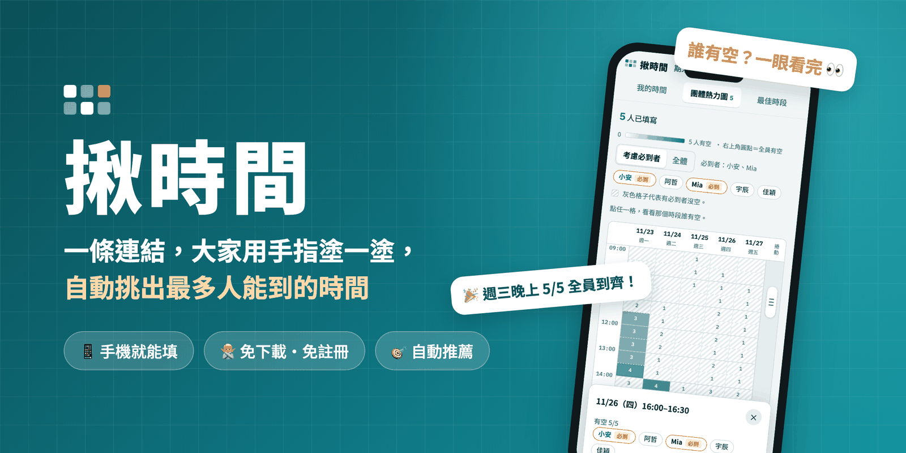
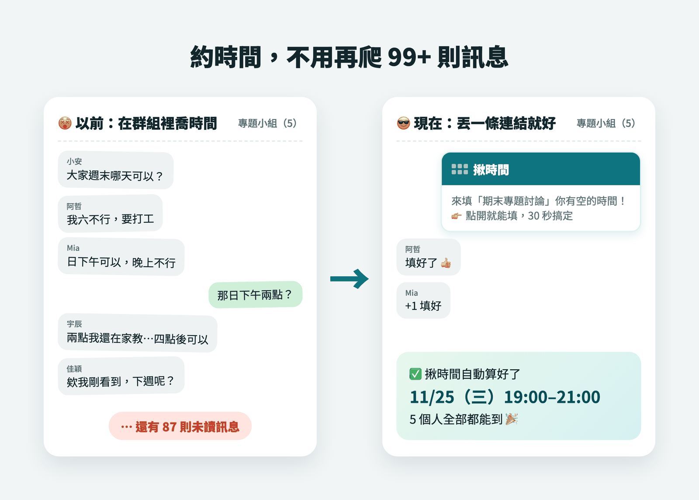
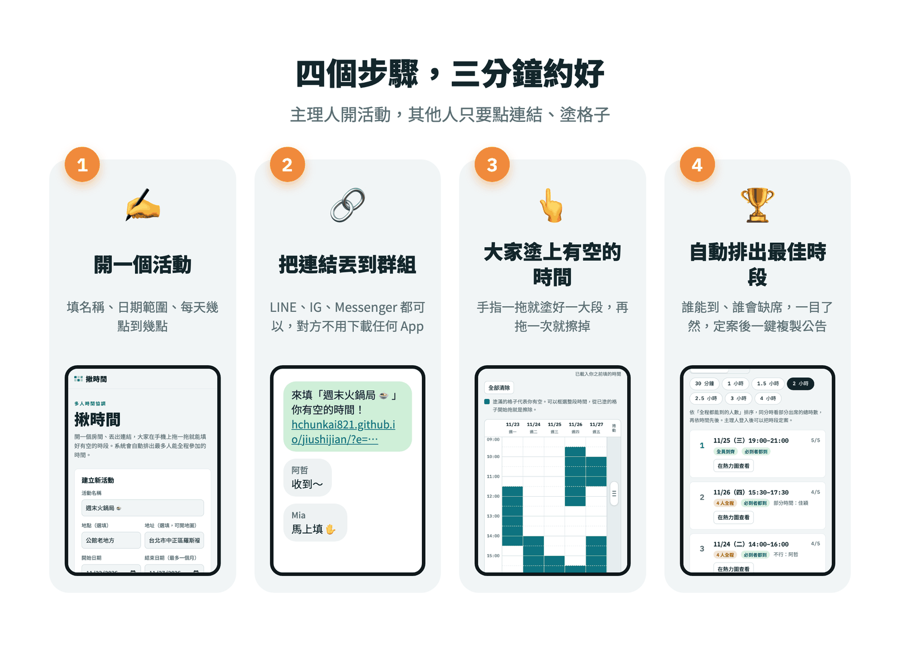
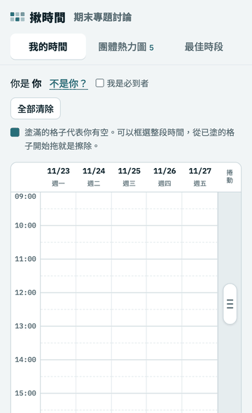
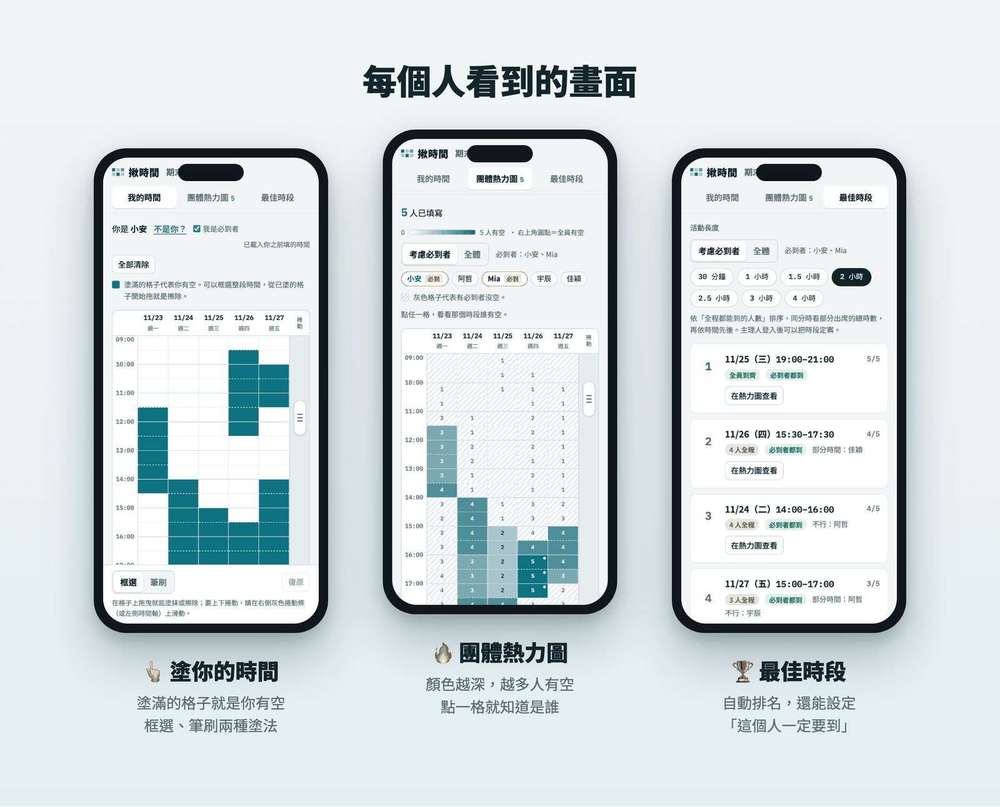

  

<h3 align="center">
  <a href="https://hchunkai821.github.io/jiushijian/">👉 馬上開一個活動</a>
  &nbsp;·&nbsp;
  <a href="https://hchunkai821.github.io/jiushijian/?demo">🎮 先玩玩看範例</a>
  &nbsp;·&nbsp;
  <a href="#常見問題">❓ 常見問題</a>
</h3>

  完全免費・沒有廣告・不用下載 App・不用註冊

  
  
  
  

---

## 🤔 這是什麼？

揪朋友吃火鍋、約組員討論期末專題、喬社團開會……**最累的永遠不是活動本身，而是「約時間」。**

在群組裡問一句「大家哪天可以？」，接下來就是幾十則訊息：有人只回星期六不行、有人晚上才看到、有人說「都可以」結果其實不行。最後還得有人一則一則整理。

**揪時間**把這件事變簡單：開一個活動、把連結丟到群組，每個人在手機上用手指把有空的時間塗起來，系統就會自動算出**最多人能全程參加的時段**。

  

## 🚀 怎麼用？

  

1. **開一個活動**：到[揪時間首頁](https://hchunkai821.github.io/jiushijian/)，填活動名稱、日期範圍（最長一個月）、每天幾點到幾點，再設一組 4 位數的「主理人密碼」。
2. **把連結丟到群組**：LINE、IG、Messenger、Email 都可以。收到的人點開就能用，不用下載任何東西。
3. **大家塗上有空的時間**：輸入暱稱和自己設的 4 位數密碼，用手指在格子上拖一拖就好。
4. **看結果**：「團體熱力圖」顏色越深代表越多人有空；「最佳時段」會直接列出推薦排名。主理人選好後按「定案」，就能一鍵複製公告貼回群組。

## 👆 用手指塗一塗就好

<table>
  <tr>
    <td width="360" align="center">
      
    </td>
    <td>
      <h3>不用一格一格點</h3>
      
手指按住、拖過去，<b>一整段時間一次塗好</b>。從已經塗好的格子開始拖，就會變成擦掉。

      
塗錯了？按一下「復原」就回來了。

      <h3>塗完馬上算好</h3>
      
你一塗完，其他人的畫面<b>立刻自動更新</b>，不用重新整理。

      <h3>換手機也沒關係</h3>
      
在新手機輸入<b>一樣的暱稱和密碼</b>，就會回到你之前塗好的時間，可以繼續改。

    </td>
  </tr>
</table>

## 📱 實際畫面

  

## ✨ 哪裡好用？

| | 功能 | 說明 |
|:-:|---|---|
| 📱 | **手機也很好填** | 專門為手機設計，手指一拖就能塗一大段；電腦用滑鼠也可以。 |
| 🙅 | **不用下載、不用註冊** | 點開連結、輸入暱稱和 4 位數密碼就能填，阿公阿嬤也會用。 |
| 🔥 | **一眼看出誰有空** | 熱力圖顏色越深越多人有空，點任何一格就知道那個時段誰可以、誰不行。 |
| 🏆 | **自動推薦最佳時段** | 依「全程都能到的人數」排名；選擇活動要多長（30 分鐘到 4 小時），推薦會跟著變。 |
| ⭐ | **「這個人一定要到」** | 可以把主揪、老師、壽星設成「必到者」，他們沒空的時段會自動排除。 |
| 📢 | **一鍵複製公告** | 定案後自動產生公告文字（時間、地點、Google 地圖連結），直接貼到群組。 |
| 🗺️ | **附上地點和地圖** | 開活動時可以填地點和地址，大家都能一鍵打開 Google 地圖。 |
| 🔒 | **別人改不了你的時間** | 每個人有自己的 4 位數密碼；主理人的管理功能也要密碼才能用。 |
| 🧹 | **用完自動清掉** | 活動建立 90 天後，所有資料會自動刪除。 |

## 🎯 適合用在

> 🍲 朋友聚餐　📚 期末專題　💼 公司開會　🏀 球隊練球　🎤 社團活動　👨‍👩‍👧 家族聚會　🎂 慶生驚喜　✈️ 揪團出遊

只要是「好幾個人要找同一個時間」，都可以用。一個活動最多 200 人。

## 🔒 安全和隱私（白話版）

- **不收集個資**：不用註冊，不會要你的 email、電話或真實姓名。只會存活動名稱、地點、你取的暱稱和你塗的時間。
- **密碼連我們都看不到**：所有密碼都經過單向加密才存起來，就算資料庫被看到也還原不出你的密碼。
- **別人猜不到你的活動**：每個活動的網址都是一串隨機代碼，沒有拿到連結的人找不到、也列不出任何活動。
- **防亂猜密碼**：密碼連續輸錯 5 次會被鎖住，而且鎖定時間會越來越長。
- **自動刪除**：活動建立 90 天後，所有資料（包含密碼）會自動刪除。
- **每次修改都有機器人把關**：每次修改程式，都會自動跑 41 項測試（其中 25 項專門模擬駭客攻擊），再交給 SonarQube 做程式碼品質與資安檢測，沒通過就不算數。

> ⚠️ **小提醒**：拿到活動連結的人都看得到這個活動的內容（暱稱、時段、地點），這是「不用註冊、傳連結就能用」的代價。所以請只把連結傳給要參加的人。

## 常見問題

<b>要錢嗎？有廣告嗎？</b>

 
完全免費，也沒有廣告。

<b>參加的人要下載 App 或註冊帳號嗎？</b>

 
都不用。點開連結就是一個網頁，輸入暱稱和自己想的 4 位數密碼就能開始填。

<b>「主理人」是誰？可以做什麼？</b>

 
開活動的人就是主理人。主理人在活動頁按右上角「主理人」、輸入開活動時設的密碼後，可以：修改活動名稱和地點、把時段定案並複製公告、設定誰是必到者、移除成員、幫忘記密碼的成員重設密碼、刪除整個活動。

<b>我忘記自己的密碼了怎麼辦？</b>

 
請主理人在「主理人」面板按你名字旁邊的「重設密碼」。之後你再輸入同樣的暱稱，就可以設定新密碼，之前塗好的時間都還在。

<b>主理人忘記主理人密碼怎麼辦？</b>

 
如果是在開活動的那支手機或電腦上，通常已經是登入狀態，不用再輸入。如果換了裝置又忘記密碼，就沒辦法找回了（我們也看不到密碼），只能重新開一個活動。

<b>日期可以排多長？格子可以多小？</b>

 
日期範圍最長一個月（例如 11/11 到 12/10）。每一格可以選 15 分鐘、30 分鐘或 1 小時，每天的時間範圍可以自己設定。

<b>電腦可以用嗎？</b>

 
可以，用滑鼠拖曳就能塗。手機上則是用手指拖曳，右側有灰色的捲動條可以上下捲。

<b>資料會保存多久？</b>

 
活動建立 90 天後，活動和所有人的填寫會自動刪除。主理人也可以隨時手動刪除活動。

<b>我想先試試看，但不想真的開活動？</b>

 
打開<a href="https://hchunkai821.github.io/jiushijian/?demo">範例活動</a>，裡面有 5 位假成員的資料，可以隨便塗，什麼都不會被儲存。

## 👩‍💻 給工程師

純 HTML / CSS / JavaScript 網站，放在 GitHub Pages；資料庫與即時同步使用 Supabase（PostgreSQL）。

- 架構、資安設計、部署與測試方式：[docs/technical.md](docs/technical.md)
- 回報資安問題：[SECURITY.md](SECURITY.md)
